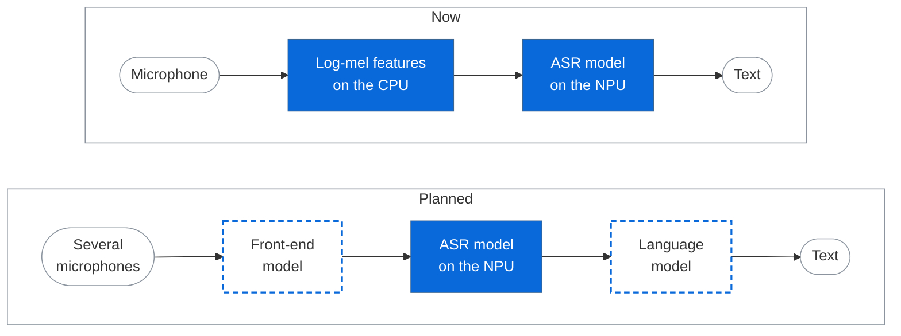

# Speech recognition on the STM32N6 microcontroller

This project implements speech recognition that runs entirely on a
microcontroller, the STM32N6. On the STM32N6570-DK board it listens to the
on-board microphone and prints English text on the display as you speak, with
no network connection and no server.

The speech is recognized by
[CynipsNet v1.0](src/asr_engine/models/cynipsnet_v1.0/README.md), a model
designed specifically for the STM32N6. It recognizes any words, not a fixed
list of commands, at a [power of 0.2 W](#power-note).
This repository holds the model weights and the complete firmware that runs
them.

> The power of 0.2 W is the peak value, drawn while the
> audio is being converted and the model is being computed. That takes the
> smaller part of the time, and the power has not been optimized yet.

## Demo
https://github.com/user-attachments/assets/37d52194-dc13-48a2-ba21-c84aa8fd977e

The subtitles show what was said; the letters in red are the ones the board
got wrong.

To repeat the demo on your own board, follow [docs/flash.md](docs/flash.md).
It explains step by step how to program the firmware the demo was recorded
with; you need the board, a USB-C cable and STM32CubeProgrammer. To build the
same firmware from source, follow [docs/setup.md](docs/setup.md).

## Accuracy and limitations

Word error rate (WER) in percent on the LibriSpeech [2] sets, lower is better.

| Model | Parameters | `dev_clean` | `dev_other` | `test-clean` | `test-other` |
|---|---:|---:|---:|---:|---:|
| QuartzNet 5x5 [1] | 6.7 M | 5.39 | 15.69 | — | — |
| QuartzNet 10x5 [1] | 12.8 M | 4.14 | 12.33 | — | — |
| **CynipsNet v1.0 baseline** | 7.2 M | **5.22** | **14.73** | **5.32** | **14.84** |

Details and the results of the quantized model are on the
[CynipsNet v1.0 page](src/asr_engine/models/cynipsnet_v1.0/README.md#accuracy).

The CynipsNet figures are for the network alone, decoded greedily and without
a language model, exactly as the firmware does it.

Besides public speech datasets, the model was trained on 248 hours of
recordings made through this board's microphone.

- English only.
- The output is plain text in capital letters: no punctuation, and numbers
  come out as words.
- With a strong accent CynipsNet v1.0 loses a lot of accuracy.
- Recognition works best within about one meter of the microphone.
- No language model is used. The text is a greedy decoding of the network
  output: at every time step the most probable character is taken, with no
  dictionary and no search over alternatives.

## Why on a microcontroller

Voice control today sits at two extremes: cheap chips that know a dozen fixed
commands, and processors or cloud services that understand free speech but
need far more power, a network connection, or both. This project is aimed at
the gap between them: free speech on a microcontroller.

| | Any words | Works offline | Low power | Low cost |
|---|:---:|:---:|:---:|:---:|
| Keyword-spotting chip | ✗ | ✓ | ✓ | ✓ |
| Cloud service | ✓ | ✗ | ✗ | ✗ |
| Microprocessor board | ✓ | ✓ | ✗ | ✗ |
| **Microcontroller with NPU** | ✓ | ✓ | ✓ | ✓ |

- **Any words:** nobody likes to memorize commands. "Make it warmer", "five
  degrees up" and "raise the temperature" all arrive as text, and the
  application can map them to the same action.
- **Works offline:** no connection, no server and no subscription. Nothing
  that is said leaves the device.
- **Low power and low cost:** a microcontroller is cheaper than a
  microprocessor board, draws several times less power and is simpler to
  design into a product.

It is not a replacement for a phone assistant or a dictation service; long
texts need models of 100 MB and more. The niche is voice commands, short
messages and voice data entry, on the device and without the internet.

## Where it can be used

- **Smart home without a cloud:** light, climate and appliances controlled in
  plain language, with no audio leaving the house.
- **Voice data entry:** meter readings, measurements and codes spoken instead
  of typed, such as "pressure one hundred thirty two".
- **Medical devices:** blood pressure monitors, glucose meters and wristbands
  where the patient adds context by voice: "after a meal", "in the morning".
- **Warehouse and logistics:** "shelf B twelve, three boxes" turned into a
  cell, a quantity and an action.

Further improvement of the accuracy and of the quality of operation can open
up other niches as well.

## How it works and what is next

The diagram shows the path from the microphone to the text: how it is
built now and how it is planned to grow.

Blue blocks are already implemented in the firmware; blocks with a dashed
outline are planned.

Now:

- **Log-mel features on the CPU:** the CPU turns the microphone signal into a
  log-mel spectrogram.
- **ASR model on the NPU:** a single model turns the spectrogram directly into
  text.

Planned:

- **A front-end model** that takes audio from one or several microphones and
  produces the spectrogram for the ASR model, to improve its operation and
  accuracy, especially in difficult conditions.
- **A language model** after the ASR model that corrects its errors.
- **Optimization:** the latency, the power consumption and the RAM usage can
  all be reduced; none of them has been optimized yet.

## License

- **Model weights:** [CC BY-NC-SA 4.0](LICENSES/CC-BY-NC-SA-4.0.txt),
  non-commercial use only. A firmware image contains the weights, so it is
  non-commercial too. For a commercial license contact
  <nikita.prismakov.dev@gmail.com>. Details and training-data attribution:
  [models/LICENSE.md](src/asr_engine/models/LICENSE.md).
- **Code, build files and documentation:** [Apache-2.0](LICENSE).
- **Display font:** glyphs derived from Liberation Sans,
  [SIL OFL 1.1](LICENSES/OFL-1.1.txt). A firmware image contains them, so
  pass [NOTICE](NOTICE) and the license text on with it.
- **Third-party software:** the ST components (HAL, CMSIS, BSP, External
  Memory Manager, NPU runtime, generated network code) keep their ST
  licenses; ThreadX is MIT. Every component is listed in
  [REUSE.toml](REUSE.toml), the license texts are in [LICENSES/](LICENSES/).

## References

[1] S. Kriman, S. Beliaev, B. Ginsburg, J. Huang, O. Kuchaiev, V. Lavrukhin,
R. Leary, J. Li and Y. Zhang, "QuartzNet: Deep Automatic Speech Recognition
with 1D Time-Channel Separable Convolutions", 2019,
<https://arxiv.org/abs/1910.10261>.

[2] V. Panayotov, G. Chen, D. Povey and S. Khudanpur, "LibriSpeech: an ASR
corpus based on public domain audio books", ICASSP 2015,
<https://www.openslr.org/12/>.
