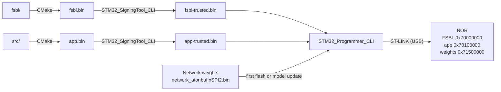

# Setup — build and flash on Windows and Linux

This guide is for building the firmware from source and programming it into
an STM32N6570-DK. You need the Arm GNU Toolchain and STM32CubeProgrammer; an
IDE is not required. Commands are run in a terminal on Linux or in Git Bash
on Windows.

If you only want to program a [released][release] firmware, see
[flash.md](flash.md).

## Pipeline



## Set up the environment

There are two ways to get the tools: install each one separately, or install
STM32CubeIDE, which brings most of them at once.

**Install each tool**

| Tool | Version used in the project | Download |
|---|---|---|
| Compiler: Arm GNU Toolchain, `arm-none-eabi` target | 13.3.rel1 | [developer.arm.com](https://developer.arm.com/downloads/-/arm-gnu-toolchain-downloads) |
| CMake | 3.22 or newer | [cmake.org](https://cmake.org/download/) |
| Build tool | any | **Linux:** Make, system package `make`<br>**Windows:** Ninja, [github.com/ninja-build](https://github.com/ninja-build/ninja/releases) |
| Programmer: STM32CubeProgrammer, with its CLI and SigningTool | 2.22.0 | [st.com](https://www.st.com/en/development-tools/stm32cubeprog.html) |
| Git | any | [git-scm.com](https://git-scm.com/downloads) |

**Or install through the IDE**

| Tool | Version used in the project | Download |
|---|---|---|
| STM32CubeIDE: GNU Tools for STM32 13.3.rel1 (the compiler), CMake, Ninja, Make and a copy of STM32CubeProgrammer | 2.0.0 | [st.com](https://www.st.com/en/development-tools/stm32cubeide.html) |
| Git | any | [git-scm.com](https://git-scm.com/downloads); on Windows it provides Git Bash |

The IDE keeps each tool in its own directory under `plugins/`, in a
`tools/bin` subdirectory. On Linux, CMake finds the IDE's compiler by itself
when the IDE is installed in `~/st/` or `/opt/st/`. In every other case,
including Windows, add the compiler's `tools/bin` directory to `PATH`; do the
same for CMake and Ninja or Make if they are not installed system-wide.

The steps below describe the first way.

### Linux 

1. Install the terminal build tools:

   ```bash
   sudo apt install git cmake make
   ```

2. Download the Arm GNU Toolchain 13.3.rel1 archive for an x86_64 Linux host
   and the `arm-none-eabi` target, unpack it and add it to `PATH`:

   ```bash
   mkdir -p "$HOME/opt"
   tar xf arm-gnu-toolchain-13.3.rel1-x86_64-arm-none-eabi.tar.xz -C "$HOME/opt"
   export PATH="$HOME/opt/arm-gnu-toolchain-13.3.rel1-x86_64-arm-none-eabi/bin:$PATH"
   ```

3. Install STM32CubeProgrammer and set its directory (adjust if installed
   elsewhere):

   ```bash
   CUBE_PROGRAMMER_BIN="$HOME/STMicroelectronics/STM32Cube/STM32CubeProgrammer/bin"
   ```

4. Install the ST-LINK udev rules that come with STM32CubeProgrammer, then
   replug the board:

   ```bash
   sudo cp "$CUBE_PROGRAMMER_BIN"/../Drivers/rules/*.rules /etc/udev/rules.d/
   sudo udevadm control --reload-rules
   ```

### Windows 10/11

1. Install **Git for Windows** (it provides Git Bash). All commands below run
   in Git Bash.
2. Download the Arm GNU Toolchain 13.3.rel1 zip archive for a Windows host
   and the `arm-none-eabi` target, unpack it into a short path and add its
   `bin` directory to `PATH` (adjust to where you unpacked it):

   ```bash
   export PATH="/c/dev/arm-gnu-toolchain-13.3.rel1-mingw-w64-i686-arm-none-eabi/bin:$PATH"
   ```

3. Install CMake and Ninja and make sure both are on `PATH`.
4. Install STM32CubeProgrammer, let its installer add the **ST-LINK
   drivers**, and set its directory (adjust if installed elsewhere):

   ```bash
   CUBE_PROGRAMMER_BIN="/c/Program Files/STMicroelectronics/STM32Cube/STM32CubeProgrammer/bin"
   ```

### Check the tools

Once everything is installed, run these commands in the terminal you will
build in. Each one must answer as shown; the exact CMake, Make, Ninja and Git
versions may differ.

| Command | Expected answer |
|---|---|
| `arm-none-eabi-gcc --version` | `arm-none-eabi-gcc (Arm GNU Toolchain 13.3.Rel1 (Build arm-13.24)) 13.3.1 20240614` |
| `cmake --version` | `cmake version 3.22` or newer |
| `make --version` (Linux) | `GNU Make 4.3` |
| `ninja --version` (Windows) | a version number, such as `1.12.1` |
| `git --version` | `git version 2.43.0` |
| `"$CUBE_PROGRAMMER_BIN/STM32_Programmer_CLI" --version` | `STM32CubeProgrammer version: 2.22.0` |
| `"$CUBE_PROGRAMMER_BIN/STM32_SigningTool_CLI" --version` | `STM32 Signing Tool v2.22.0` |
| `ls "$CUBE_PROGRAMMER_BIN/ExternalLoader/MX66UW1G45G_STM32N6570-DK.stldr"` | the path of the file, without an error |


If you open a new terminal, run the `export PATH=...` and
`CUBE_PROGRAMMER_BIN=...` lines from the installation steps again: they apply
only to the terminal they were typed in.

On Windows the two CubeProgrammer tools may need the `.exe` suffix:
`STM32_Programmer_CLI.exe`, `STM32_SigningTool_CLI.exe`.

## Build

Clone the repository with its submodule. On Windows, clone into a short path
without spaces or non-ASCII characters, such as `C:/dev/`.

```bash
git clone --recursive -c core.autocrlf=false https://github.com/fotonik-sk/stm32n6-asr.git stm32n6-asr
cd stm32n6-asr
```

If already cloned, start in the repository root and initialize the submodule:

```bash
git submodule update --init --recursive
```

Build both images from the repository root. Release mode omits debug symbols
and reduces disk use. The repository supplies the prebuilt network library
and the ready-to-flash weights in the network's directory under
`src/asr_engine/models/`.

```bash
cd fsbl
cmake --preset default -DCMAKE_BUILD_TYPE=Release -DSTM32_C_OPTIMIZATION=-Os
cmake --build build
cd ..

cmake --preset default -DCMAKE_BUILD_TYPE=Release -DSTM32_C_OPTIMIZATION=-Os
cmake --build --preset app
```

On Windows, add `-G Ninja` to both `cmake --preset default` commands.

The build produces `fsbl/build/application/fsbl.bin` and
`build/src/application/app.bin`.

A build directory remembers its generator; use fresh `build/` and
`fsbl/build/` directories when switching between Make and Ninja.

## Sign

Add the STM32N6 image headers. `-nk` creates unencrypted images without keys;
`-s` overwrites the outputs of a previous run without prompting:

```bash
"$CUBE_PROGRAMMER_BIN/STM32_SigningTool_CLI" -s \
  -bin fsbl/build/application/fsbl.bin -nk -of 0x80000000 -t fsbl \
  -o build/fsbl-trusted.bin -hv 2.3 -align

"$CUBE_PROGRAMMER_BIN/STM32_SigningTool_CLI" -s \
  -bin build/src/application/app.bin -nk -of 0x80000000 -t fsbl \
  -o build/app-trusted.bin -hv 2.3 -align
```

Repeat this step after every rebuild: the flash command programs the
`*-trusted.bin` files, which do not change until they are signed again.

## Prepare the board

- Connect the board's **ST-LINK_V3EC USB Type-C** port to the PC; it also
  powers the board. The power-source jumper **JP2** must be in position **1-2:
  5V_STLK**.
- The two boot switches: **BOOT0 (SW2)** stays at **L** (left) all the time;
  **BOOT1 (SW1)** selects the mode:

| BOOT1 (SW1) | Mode | Used for |
|---|---|---|
| **H** (right) | development: the bootROM waits for the debugger | flashing |
| **L** (left) | boot from external flash | normal operation |

After moving a switch press **RESET**; if the board does not start in the new
mode, unplug and replug the USB cable.

## Flash and run

1. Set BOOT1 = **H**, then reset or power-cycle the board.
2. Run the command below from the repository root to program the FSBL,
   application and network weights. The `*` expands to the one network
   directory that ships weights.

   ```bash
   "$CUBE_PROGRAMMER_BIN/STM32_Programmer_CLI" \
     -c port=SWD freq=24000 ap=1 \
     -el "$CUBE_PROGRAMMER_BIN/ExternalLoader/MX66UW1G45G_STM32N6570-DK.stldr" \
     -d build/fsbl-trusted.bin 0x70000000 \
     -d build/app-trusted.bin 0x70100000 \
     -d src/asr_engine/models/*/network_atonbuf.xSPI2.bin 0x71500000 \
     -v
   ```

3. Set BOOT1 = **L**, then reset or power-cycle the board.
4. The red LED lights briefly (FSBL), the LCD shows the logo and the green LED
   blinks. Speak English near the board: the text appears on the LCD.

The weights already use the byte order expected in NOR; no conversion is
needed. Program them once per network: for subsequent firmware updates, omit
the last `-d` option (the weights filename and address `0x71500000`).

### Serial console (optional)

The firmware also writes its log and the recognized text to a serial port,
which the ST-LINK USB connection exposes as a virtual COM port. Any serial
terminal works with these settings:

| Parameter | Value |
|---|---|
| Baud rate | 921600 |
| Data bits | 8 |
| Parity | none |
| Stop bits | 1 |
| Flow control | none |

After a reset the log contains the line
`STM32N6570-DK, firmware v…, model …`.

## Problems and fixes

| Symptom | Cause and fix |
|---|---|
| CubeProgrammer cannot connect to the target | Board not in development mode: BOOT1 = H, then RESET or replug. For an unstable link, change `freq=24000` to `freq=8000` in the flash command. |
| CubeProgrammer asks for an ST-LINK firmware upgrade | Upgrade the ST-LINK firmware from the STM32CubeProgrammer GUI (**Firmware upgrade** in the ST-LINK configuration panel), then retry. |
| Nonsense text, or only noise-like letters | Weights missing or from another network: repeat the flash command including the weights at `0x71500000`. |

[release]: https://github.com/fotonik-sk/stm32n6-asr/releases/latest
