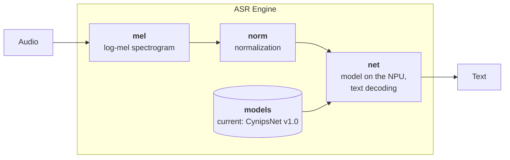

# ASR Engine — on-device speech recognition for STM32N6

`asr_engine` turns speech into text on the STM32N6 microcontroller. The host
project gives it audio from a microphone and receives the recognized
text; everything in between happens inside this module.

The engine consists of two parts:

- **A set of models** developed for the NPU of the STM32N6. At present there
  is one, CynipsNet v1.0.
- **A pipeline built for that model.** It prepares the audio exactly the way
  the model expects, runs the model on the NPU and turns its output into
  text.

## Models

| Model | WER, `dev_clean` | WER, `dev_other` | Description |
|---|---:|---:|---|
| CynipsNet v1.0 | 5.79 % | 15.31 % | [models/cynipsnet_v1.0](models/cynipsnet_v1.0/README.md) |

The word error rate (WER) was measured on the standard LibriSpeech [1] validation
sets dev-clean and dev-other. The model's page has the full accuracy table,
including recordings made through the board's microphone and a comparison
with published models.

## Structure

Audio passes through three stages, each in its own directory and its own
thread, and comes out as text:

| Part | What it does | Runs on |
|---|---|---|
| [`mel/`](mel/README.md) | Turns the audio into a log-mel spectrogram. | CPU |
| [`norm/`](norm/README.md) | Normalizes the spectrogram and hands it to the model window by window. | CPU |
| [`net/`](net/README.md) | Runs the model over the window and decodes its output into letters. | NPU, decoding on the CPU |
| [`models/`](models/cynipsnet_v1.0/README.md) | The models the `net` stage can run: compiled network, weights and description. | — |

The pipeline is fitted to the model: the spectrogram, the normalization and
the window are exactly those the model was trained with. Changing any of them
will most likely lower the accuracy.

## Integration into other projects

This module is planned to become a separate git submodule, so that it can be
integrated into other projects. It is not there yet:

- **Dependencies.** The module depends on parts of this project: the ThreadX
  RTOS, the logger and a configuration header supplied by the host. A project
  that integrates the module has to provide them.
- **Memory.** The model is compiled for fixed memory regions: its weights are
  read from external flash at a fixed address, and its working memory occupies
  fixed ranges of internal SRAM and PSRAM. The host project must leave these
  regions free and place the weights there. The ranges are listed on the
  [model's page](models/cynipsnet_v1.0/README.md#memory).

## References

[1] V. Panayotov, G. Chen, D. Povey and S. Khudanpur, "LibriSpeech: an ASR
corpus based on public domain audio books", ICASSP 2015,
<https://www.openslr.org/12/>.
